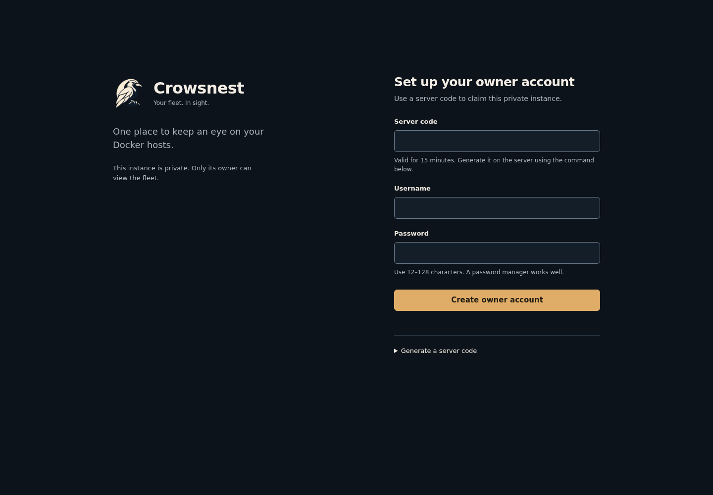
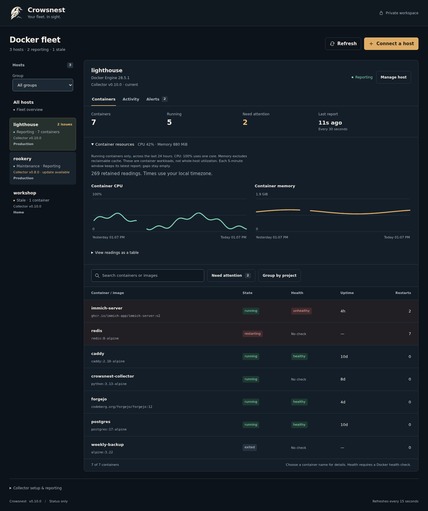
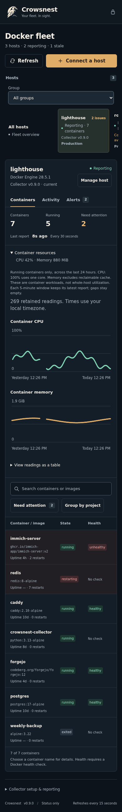
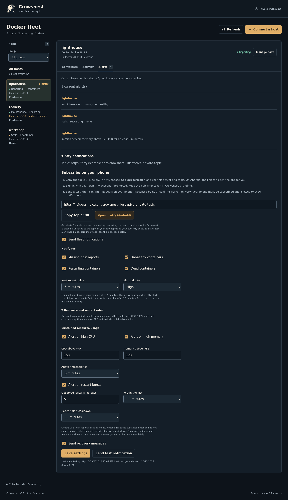
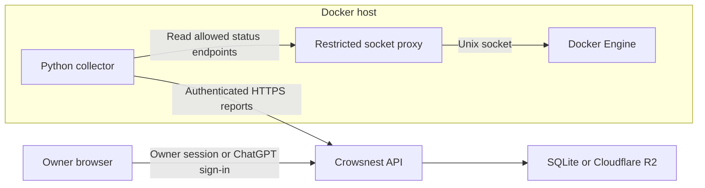

<p align="center">
  
</p>

# Crowsnest

**Your fleet. In sight.**

Crowsnest is a private dashboard for Docker host and container status. Run your own instance with Docker Compose or host it through ChatGPT Sites. A small outbound collector on each host gives you one place to check container state, health, uptime, and restart counts.


*Actual UI with fictional host data. [Screenshot provenance](docs/screenshots/README.md).*

<details>
<summary>Mobile view</summary>
<p></p>
</details>

<details>
<summary>Host setup</summary>
<p></p>
</details>

<details>
<summary>Container details</summary>
<p></p>
</details>

<details>
<summary>Self-hosted owner setup</summary>
<p></p>
</details>

<details>
<summary>Resource history</summary>
<p></p>
<p></p>
</details>

<details>
<summary>Notification rules</summary>
<p></p>
</details>

## Features

- Multiple Docker hosts in one private dashboard.
- Host groups that scope containers, activity, and current alerts.
- Optional container CPU/memory details and bounded 24-hour host and per-container workload history, with labeled charts and a readings table.
- Opt-in sustained resource alerts, observed restart bursts, per-container cooldowns, and direct links from ntfy notifications.
- Standalone Docker deployment with an owner account, persistent SQLite storage, and automatic alert checks.
- Short-lived setup/recovery codes, private browser sessions, and consistent backup/restore commands.
- Compose project grouping, service labels, and project/service search.
- Separate process-state and Docker health indicators.
- Reports every 30 seconds, with stale-data detection after two minutes.
- A restricted Docker socket proxy and no published collector ports.
- Installation under `/srv/docker` with user-owned files and private credentials.
- Search by container or image, plus a filter for containers that need attention.
- Fleet-wide container and host search with clearly labeled stale reports.
- Copy-and-paste Compose setup, file review, and first-report confirmation, with an optional package download.
- Host renaming, removal, and staged reporting-token replacement.
- Recent activity and alerts for stale hosts and unhealthy, restarting, or dead containers.
- Optional authenticated ntfy notifications, phone subscription help, recovery messages, and retry backoff.
- Notification category, host-delay, and priority controls for the whole fleet.
- Timed per-host maintenance pauses with automatic notification resumption.
- Copyable collector updates that preserve reporting credentials and user permissions.
- Per-host collector versions, update guidance, and confirmation from a fresh report.
- Container details with image, state, health, timestamps, restart count, Compose metadata, copyable ID, and recent changes.

Crowsnest displays the latest status and records recent changes without controlling containers. Activity retains up to 100 events per host from the last 30 days; workload history retains up to 288 readings over 24 hours, capped at 2 MiB per host. Large hosts may retain fewer readings. Resource collection is optional and older collectors remain compatible. See [resource measurements](docs/resources.md) and [notification setup](docs/notifications.md).

## Quick start

Deploy your own dashboard with the [self-hosting guide](docs/self-hosting.md). It covers HTTPS, owner setup, notifications, upgrades, backups, and recovery.

For ChatGPT hosting, follow [ChatGPT Sites setup](docs/chatgpt-sites.md) and use the clean source export.

To connect a host, you need a private Crowsnest dashboard, a Linux host with Docker Engine and Docker Compose v2, and Docker access directly or through sudo.

1. Open your dashboard and choose **Connect a host**.
2. Enter a unique host name and choose **Prepare setup**.
3. Choose **Copy setup** and paste into a Bash terminal on the host to prepare its private Compose files.
4. When the terminal prints **Private Compose files prepared**, choose **Files prepared — continue**.
5. Review the files and run the displayed start commands as your normal user. Choose whether Docker commands need sudo.
6. Choose **I’ve started the collector** and wait for an actual report to confirm connection.

The default directory is `/srv/docker/crowsnest-collector`. Setup creates a private directory owned by your user and refuses to overwrite an existing installation. **Download and transfer instead** remains available as an alternative.

Check the collector:

```bash
cd /srv/docker/crowsnest-collector
sudo docker compose logs -f collector
```

Omit sudo if your account already has Docker access. Successful reporting logs `Status delivered: ... containers`. The dashboard should show the host as **Reporting**.

Copied setup and the Compose package contain reporting credentials. Keep the clipboard, any terminal history containing the setup, and `collector.json` private. Do not commit generated installation files. A host left awaiting its first report has a **Continue setup** action.

See the [installation guide](docs/deployment.md) for custom paths, collector updates, and maintenance. Choose a container name to open [container details](docs/container-details.md).

## Architecture



The collector sends a limited set of status fields; it does not transmit container environment variables, logs, mounts, or network addresses. Standalone deployments authenticate an owner account and store data in SQLite; ChatGPT Sites deployments use platform sign-in and R2. Each host has a separate reporting token.

Read the [architecture guide](docs/architecture.md) and [security policy](SECURITY.md) for the trust boundaries and configuration model.

## Development

Use Node.js 22.13 or newer, Bash, Git, GNU tar, Linux `flock`, and Python 3 on Linux. The Worker has no runtime npm dependencies; the standalone server uses the pinned `better-sqlite3` package.

```bash
npm ci --ignore-scripts --no-audit --no-fund
npm run check
```

Checks cover the Worker build, API behavior, generated installers, standalone authentication/storage, and common secret patterns. CI also tests the isolated Docker runtime. The Security workflow adds Gitleaks history scanning, application security rules, dependency auditing, and container vulnerability scanning. GitHub Actions runs the checks on pushes and pull requests, with weekly security scans. Tests use fictional data and do not contact the production dashboard.

See [development and validation](docs/development.md) for build output, test coverage, and live integration checks.

## Documentation

| Guide | Contents |
| --- | --- |
| [Self-hosting](docs/self-hosting.md) | Docker deployment, owner sign-in, HTTPS, backup/restore, and recovery |
| [ntfy notifications](docs/notifications.md) | Private topics, delivery, and background checks |
| [Collector installation](docs/deployment.md) | New hosts, custom paths, updates, and maintenance |
| [Container details](docs/container-details.md) | Container facts, recent changes, freshness, and collector versions |
| [ChatGPT Sites setup](docs/chatgpt-sites.md) | Separate private deployments and distribution readiness |
| [Roadmap](docs/roadmap.md) | Future monitoring features |
| [Versioning](docs/versioning.md) | Compatibility, changelog, and release procedure |
| [Configuration](docs/configuration.md) | Runtime bindings, collector configuration, paths, and limits |
| [Architecture](docs/architecture.md) | Data flow, access control, and hosting |
| [Troubleshooting](docs/troubleshooting.md) | Permissions, reporting errors, and stale hosts |
| [Development](docs/development.md) | Local checks, CI, and release validation |
| [Interface design](DESIGN.md) | Shared layout, interaction, branding, and accessibility conventions |
| [Contributing](CONTRIBUTING.md) | Change scope, review, and validation expectations |
| [Security](SECURITY.md) | Credential handling and vulnerability reporting |
| [Brand assets](worker/assets/README.md) | Logo and generation brief |

## Compatibility and limitations

New installations use the Crowsnest directory, Compose project, and container names. Existing collectors remain accepted; update and credential replacement commands also locate earlier default installations. See [migration guidance](docs/deployment.md#migrate-an-existing-installation) to adopt the new names without rotating credentials.

This version supports one collector installation per Docker daemon and up to 100 registered hosts. A host report supports up to 250 containers and 128 KiB. Rootless Docker requires manual socket-path and user-mapping adjustments. Host management replaces reporting credentials; changing the platform service credential still requires updating every collector.

The current product version is **0.11.1**. See the [changelog](CHANGELOG.md) and [versioning policy](docs/versioning.md).

GitHub stores source and runs checks. Pushing source does not update a running instance. Rebuild standalone Compose deployments deliberately; ChatGPT Sites deployments use the Sites publication process.

## Support and maintenance

Maintained by [@bthall](https://github.com/bthall). Use repository issues for bugs and feature requests, with secrets removed from any diagnostic information. Follow [SECURITY.md](SECURITY.md) for security concerns.

Licensed under the [MIT license](LICENSE).
