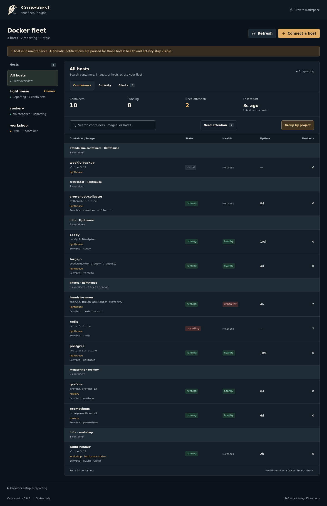
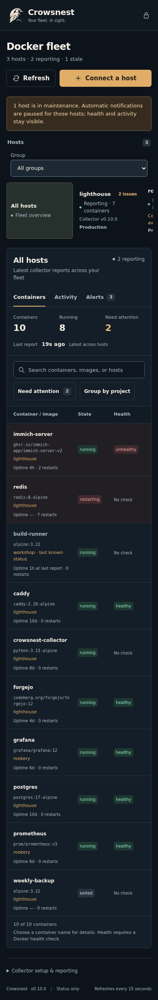
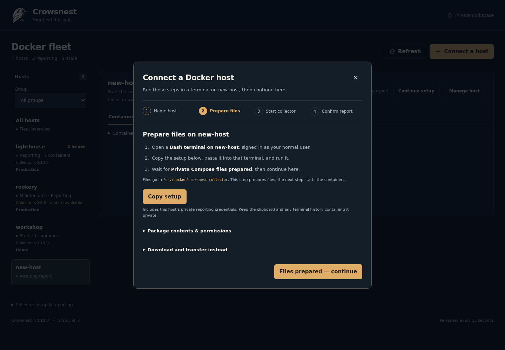
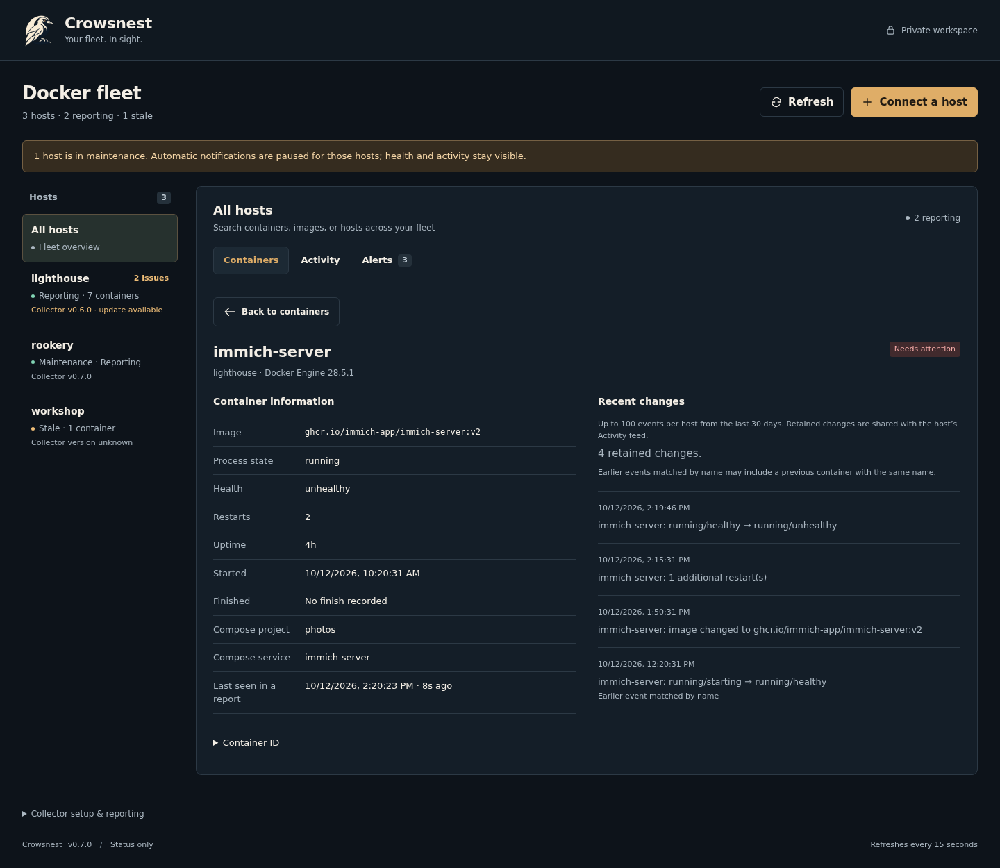
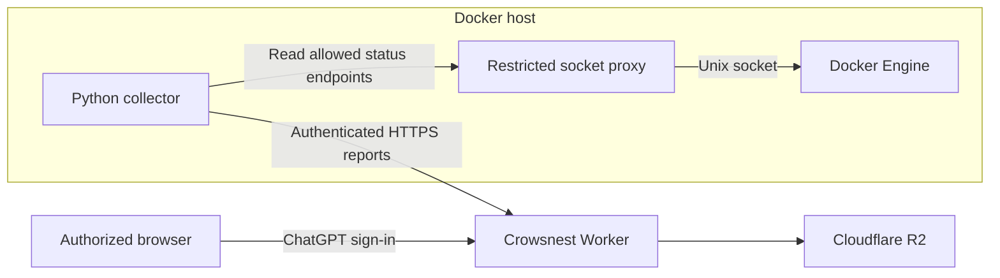

<p align="center">
  
</p>

# Crowsnest

**Your fleet. In sight.**

Crowsnest is a private dashboard for Docker host and container status. A small outbound collector on each host sends reports to a dashboard hosted through ChatGPT Sites. It gives you one place to check container state, health, uptime, and restart counts.



*Actual UI with fictional host data. [Screenshot provenance](docs/screenshots/README.md).*

<details>
<summary>Mobile view</summary>
<p></p>
</details>

<details>
<summary>Host setup</summary>
<p></p>
</details>

<details>
<summary>Container details</summary>
<p></p>
</details>

## Features

- Multiple Docker hosts in one private dashboard.
- Compose project grouping, service labels, and project/service search.
- Separate process-state and Docker health indicators.
- Reports every 30 seconds, with stale-data detection after two minutes.
- A restricted Docker socket proxy and no published collector ports.
- Installation under `/srv/docker` with user-owned files and private credentials.
- Search by container or image, plus a filter for containers that need attention.
- Fleet-wide container and host search with clearly labeled stale reports.
- Copy-and-paste Compose setup, file review, and first-report confirmation, with an optional package download.
- Host renaming, removal, and staged reporting-token replacement.
- Recent activity and alerts for stale hosts and unhealthy, restarting, or dead containers.
- Optional authenticated ntfy notifications, phone subscription help, recovery messages, and retry backoff.
- Timed per-host maintenance pauses with automatic notification resumption.
- Copyable collector updates that preserve reporting credentials and user permissions.
- Per-host collector versions, update guidance, and confirmation from a fresh report.
- Container details with image, state, health, timestamps, restart count, Compose metadata, copyable ID, and recent changes.

Crowsnest displays the latest status and records recent changes. It does not control containers or retain historical metrics. Activity retains up to 100 events per host from the last 30 days; optional ntfy delivery works while the dashboard is closed. See [notification setup](docs/notifications.md) for authentication and unattended stale-host checks.

## Quick start

For a separate dashboard, follow [ChatGPT Sites setup](docs/chatgpt-sites.md) and use the clean source export.

You need an existing private Crowsnest dashboard, a Linux host with Docker Engine and Docker Compose v2, and Docker access directly or through sudo.

1. Open your dashboard and choose **Connect a host**.
2. Enter a unique host name and choose **Prepare setup**.
3. Choose **Copy setup** and paste into a Bash terminal on the host to prepare its private Compose files.
4. When the terminal prints **Private Compose files prepared**, choose **Files prepared — continue**.
5. Review the files and run the displayed start commands as your normal user. Choose whether Docker commands need sudo.
6. Choose **I’ve started the collector** and wait for an actual report to confirm connection.

The default directory is `/srv/docker/docker-dashboard-collector`. Setup creates a private directory owned by your user and refuses to overwrite an existing installation. **Download and transfer instead** remains available as an alternative.

Check the collector:

```bash
cd /srv/docker/docker-dashboard-collector
sudo docker compose logs -f collector
```

Omit sudo if your account already has Docker access. Successful reporting logs `Status delivered: ... containers`. The dashboard should show the host as **Reporting**.

Copied setup and the Compose package contain reporting credentials. Keep the clipboard, any terminal history containing the setup, and `collector.json` private. Do not commit generated installation files. A host left awaiting its first report has a **Continue setup** action.

See the [installation guide](docs/deployment.md) for custom paths, collector updates, and maintenance. Choose a container name to open [container details](docs/container-details.md).

## Architecture



The collector sends a limited set of status fields; it does not transmit container environment variables, logs, mounts, or network addresses. Dashboard access is enforced by ChatGPT Sites, and each host has a separate reporting token.

Read the [architecture guide](docs/architecture.md) and [security policy](SECURITY.md) for the trust boundaries and configuration model.

## Development

Use Node.js 22.13 or newer, Bash, Git, and Python 3 on Linux. The Worker has no npm dependencies.

```bash
npm ci --ignore-scripts --no-audit --no-fund
npm run check
```

Checks cover the Worker build, API behavior, generated installers, and common secret patterns. The Security workflow adds Gitleaks history scanning and application security rules. GitHub Actions runs the checks on pushes and pull requests, with weekly security scans. Tests use storage and Docker command doubles; they do not contact the production dashboard.

See [development and validation](docs/development.md) for build output, test coverage, and live integration checks.

## Documentation

| Guide | Contents |
| --- | --- |
| [ntfy notifications](docs/notifications.md) | Private topics, delivery, and background checks |
| [Collector installation](docs/deployment.md) | New hosts, custom paths, updates, and maintenance |
| [Container details](docs/container-details.md) | Container facts, recent changes, freshness, and collector versions |
| [ChatGPT Sites setup](docs/chatgpt-sites.md) | Separate private deployments and distribution readiness |
| [Roadmap](docs/roadmap.md) | Resource usage candidates |
| [Versioning](docs/versioning.md) | Compatibility, changelog, and release procedure |
| [Configuration](docs/configuration.md) | Runtime bindings, collector configuration, paths, and limits |
| [Architecture](docs/architecture.md) | Data flow, access control, and hosting |
| [Troubleshooting](docs/troubleshooting.md) | Permissions, reporting errors, and stale hosts |
| [Development](docs/development.md) | Local checks, CI, and release validation |
| [UI polish](docs/ui-polish.md) | Codex tools, design decisions, and browser validation |
| [Contributing](CONTRIBUTING.md) | Change scope, review, and validation expectations |
| [Security](SECURITY.md) | Credential handling and vulnerability reporting |
| [Brand assets](worker/assets/README.md) | Logo and generation brief |

## Compatibility and limitations

The product name is Crowsnest. Existing collector filenames, the `docker-dashboard` Compose project, container names, paths, and API routes remain compatible with existing installations.

This version supports one collector installation per Docker daemon and up to 100 registered hosts. A host report supports up to 250 containers and 128 KiB. Rootless Docker requires manual socket-path and user-mapping adjustments. Host management replaces reporting credentials; changing the platform service credential still requires updating every collector.

The current product version is **0.7.2**. See the [changelog](CHANGELOG.md), [project review](docs/code-review.md), and [versioning policy](docs/versioning.md).

GitHub stores source and runs checks. Pushing to this repository does not publish the dashboard; deployment remains managed through ChatGPT Sites.

## Support and maintenance

Maintained by [@bthall](https://github.com/bthall). Use repository issues for bugs and feature requests, with secrets removed from any diagnostic information. Follow [SECURITY.md](SECURITY.md) for security concerns.

No license has been selected for this repository.
