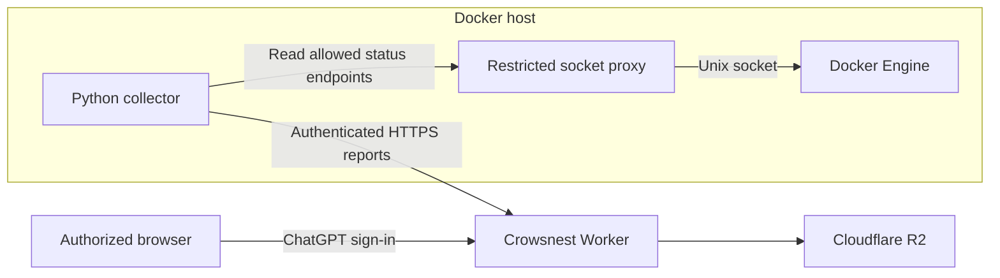

<p align="center">
  
</p>

# Crowsnest

**Your fleet. In sight.**

Crowsnest is a private dashboard for Docker host and container status. A small outbound collector on each host sends reports to a dashboard hosted through ChatGPT Sites. It gives you one place to check container state, health, uptime, and restart counts.


*Actual UI with fictional host data. [Screenshot provenance](docs/screenshots/README.md).*

<details>
<summary>Mobile view</summary>
<p></p>
</details>

## Features

- Multiple Docker hosts in one private dashboard.
- Separate process-state and Docker health indicators.
- Reports every 30 seconds, with stale-data detection after two minutes.
- A restricted Docker socket proxy and no published collector ports.
- Installation under `/srv/docker` with user-owned files and private credentials.
- Search by container or image, plus a filter for containers that need attention.

Crowsnest displays the latest status. It does not control containers or retain historical metrics.

## Quick start

For a separate dashboard, follow [ChatGPT Sites setup](docs/chatgpt-sites.md) and use the clean source export.

You need an existing private Crowsnest dashboard, a Linux host with Docker Engine and Docker Compose v2, and Docker access directly or through sudo.

1. Open your dashboard and choose **Connect a host**.
2. Enter a unique host name and download `docker-watch-setup.sh`.
3. Review the script and transfer it privately to the Docker host.
4. Run it as your normal user:

   ```bash
   bash docker-watch-setup.sh
   ```

The default directory is `/srv/docker/docker-dashboard-collector`. The script asks for sudo when directory creation or Docker access requires it. It refuses to overwrite an existing installation.

Check the collector:

```bash
cd /srv/docker/docker-dashboard-collector
sudo docker compose logs -f collector
```

Omit sudo if your account already has Docker access. Successful reporting logs `Status delivered: ... containers`. The dashboard should show the host as **Reporting**.

The downloaded setup script contains reporting credentials. Keep it and `collector.json` private. Do not commit generated installation files.

See the [installation guide](docs/deployment.md) for custom paths and maintenance.

## Architecture



The collector sends a limited set of status fields; it does not transmit container environment variables, logs, mounts, or network addresses. Dashboard access is enforced by ChatGPT Sites, and each host has a separate reporting token.

Read the [architecture guide](docs/architecture.md) and [security policy](SECURITY.md) for the trust boundaries and configuration model.

## Development

Use Node.js 22.13 or newer, Bash, Git, and Python 3 on Linux. The Worker has no npm dependencies.

```bash
npm ci --ignore-scripts --no-audit --no-fund
npm run check
```

Checks cover the Worker build, API behavior, generated installers, and common secret patterns. The Security workflow adds Gitleaks history scanning and application security rules. GitHub Actions runs the checks on pushes and pull requests, with weekly security scans. Tests use storage and Docker command doubles; they do not contact the production dashboard.

See [development and validation](docs/development.md) for build output, test coverage, and live integration checks.

## Documentation

| Guide | Contents |
| --- | --- |
| [Collector installation](docs/deployment.md) | New hosts, custom paths, and maintenance |
| [ChatGPT Sites setup](docs/chatgpt-sites.md) | Separate private deployments and distribution readiness |
| [Versioning](docs/versioning.md) | Compatibility, changelog, and release procedure |
| [Configuration](docs/configuration.md) | Runtime bindings, collector configuration, paths, and limits |
| [Architecture](docs/architecture.md) | Data flow, access control, and hosting |
| [Troubleshooting](docs/troubleshooting.md) | Permissions, reporting errors, and stale hosts |
| [Development](docs/development.md) | Local checks, CI, and release validation |
| [UI polish](docs/ui-polish.md) | Codex tools, design decisions, and browser validation |
| [Contributing](CONTRIBUTING.md) | Change scope, review, and validation expectations |
| [Security](SECURITY.md) | Credential handling and vulnerability reporting |
| [Brand assets](worker/assets/README.md) | Logo and generation brief |

## Compatibility and limitations

The product name is Crowsnest. Existing collector filenames, the `docker-dashboard` Compose project, container names, paths, and API routes remain compatible with existing installations.

This version supports one collector installation per Docker daemon and up to 100 registered hosts. A host report supports up to 250 containers and 128 KiB. Rootless Docker requires manual socket-path and user-mapping adjustments. Credential recovery, token rotation, and host deletion do not have dashboard controls.

The current product version is **0.2.1**. See the [changelog](CHANGELOG.md) and [versioning policy](docs/versioning.md).

GitHub stores source and runs checks. Pushing to this repository does not publish the dashboard; deployment remains managed through ChatGPT Sites.

## Support and maintenance

Maintained by [@bthall](https://github.com/bthall). Use repository issues for bugs and feature requests, with secrets removed from any diagnostic information. Follow [SECURITY.md](SECURITY.md) for security concerns.

No license has been selected for this repository.
